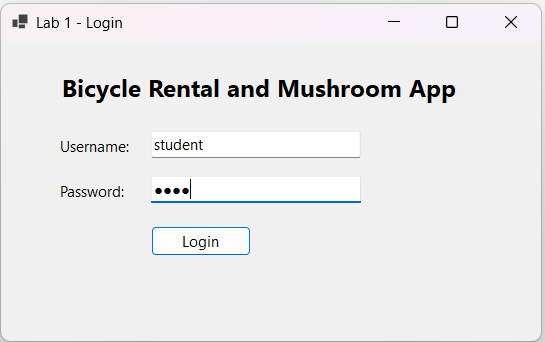
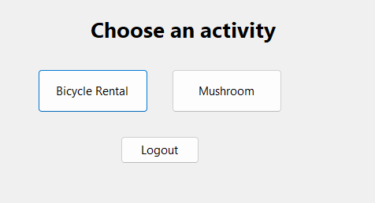
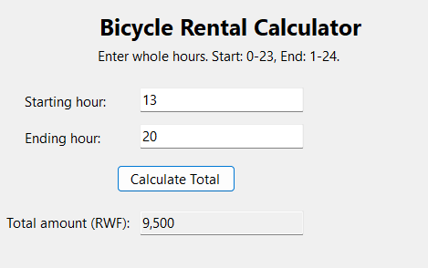
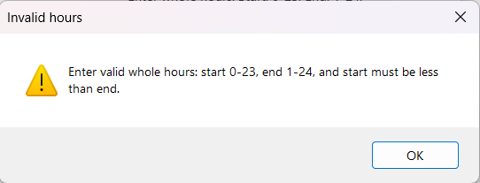
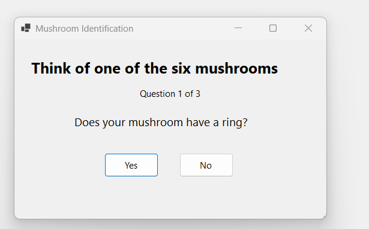
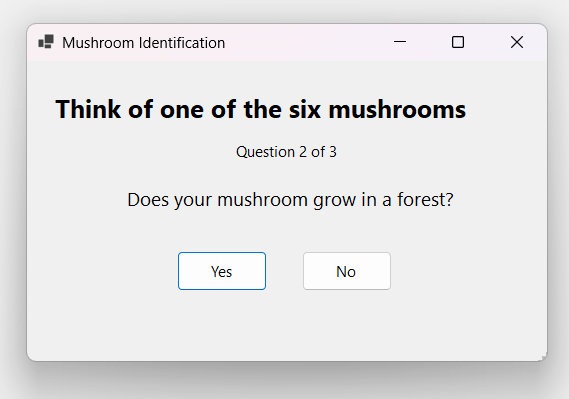
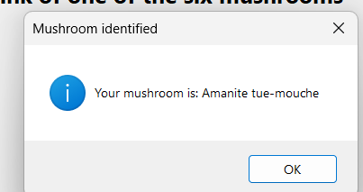

# .NET Lab 2 – Bicycle Rental and Mushroom Identification

**Student:** Tracy Uwase  
**Student ID:** 27105  
**Technology:** C# Windows Forms  
**Target framework:** .NET 10

## Project description

This mini project is a Windows Forms application developed for Lab 2. It demonstrates:

- Variables and data types
- User input and validation
- Arithmetic operations
- `if` statements
- Loops
- Multiple Windows Forms
- Button click events
- Message boxes and text boxes

The application contains two practical problems:

1. A bicycle rental calculator.
2. A mushroom identification program.

## Application flow

```text
Login Form
	↓
Activity Selection Form
	├── Bicycle Rental Form
	└── Mushroom Identification Form
```

## Login

Use the classroom test credentials:

```text
Username: student
Password: 1234
```

After a successful login, the activity selection form opens.

## Bicycle rental calculator

The user enters a starting hour and an ending hour. The application validates that:

- The starting hour is between `0` and `23`.
- The ending hour is between `1` and `24`.
- The starting hour is less than the ending hour.
- Decimal numbers and invalid text are rejected.

### Hourly rates

| Time range | Rate per hour |
|---|---:|
| 00:00–07:00 | 500 RWF |
| 07:00–14:00 | 1,000 RWF |
| 14:00–19:00 | 1,500 RWF |
| 19:00–21:00 | 1,000 RWF |
| 21:00–24:00 | 500 RWF |

The program checks each rented hour, adds the correct rate, and displays the total amount in the result textbox.

## Mushroom identification

The user thinks of one of six mushrooms and answers Yes or No questions:

- Does it have a ring?
- Does it grow in a forest?
- Does it have gills?
- Does it have a convex cup?

The program asks no more than three questions and displays the identified mushroom in a message box.

The possible results are:

- Agaric jaunissant
- Amanite tue-mouche
- Cepe de bordeaux
- Coprin chevelu
- Girolle
- Pied bleu

## Screenshots

### Login form



### Activity selection form



### Bicycle rental form



### Mushroom identification form



### Mushroom question 1



### Mushroom question 2



### Mushroom result


